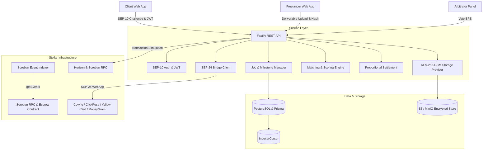
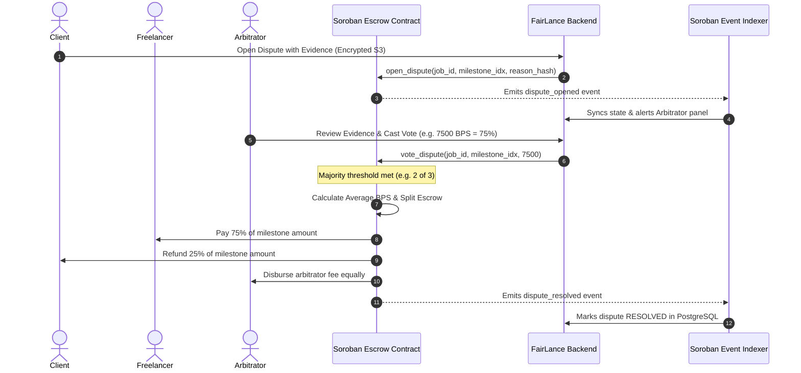

# Escrow-FairLance Backend Service (`Gig-escrow-service`)

> Enterprise-grade backend microservice for **Escrow-FairLance**, a decentralized freelancer escrow protocol powered by Stellar & Soroban smart contracts, encrypted deliverable storage, and SEP-24 localized fiat rails.

---

## Architecture Overview



---

## Key Capabilities

1. **Stellar Web Authentication (SEP-10)**:
   - Challenge transactions signed by server with cryptographic nonces and 5-minute timebounds.
   - Verified on-ledger keypair signatures generating role-aware JWT bearer tokens.
2. **Canonical Terms & Milestone Hashing**:
   - Deterministic JSON key serialization (`canonicalJsonStringify`) yielding immutable SHA-256 hashes matching on-chain Soroban contract storage.
3. **Encrypted Deliverable Storage**:
   - Multi-provider abstraction (Local disk / AWS S3 / MinIO).
   - Envelope encryption using **AES-256-GCM** with 12-byte initialization vectors and 16-byte authentication tags.
   - Cryptographic tamper protection with constant-time equality checks.
4. **Milestone Lifecycle with 2-Revision Limit**:
   - Submission of deliverable hashes (`deliverable_hash`).
   - Strict enforcement of $\le 2$ client revision requests. If client requests a 3rd revision, platform requires approval or dispute opening.
   - Permissionless auto-release upon review window expiration.
5. **Arbitrator Pool Matching & Proportional Settlement**:
   - Strict **conflict-of-interest exclusion** (arbitrator cannot be client or freelancer).
   - Odd-sized panel recommendation ($1, 3, 5, 7$).
   - Consensus averaging of arbitrator votes ($0 \dots 10,000$ basis points).
   - Dynamic reputation scoring:
     $$\text{Score} = \max\left(10, 100 + (\text{voted} \times 2.5) - (\text{slashed} \times 35)\right)$$
6. **Soroban RPC Event Indexer**:
   - Persistent `IndexerCursor` tracking `lastLedger` and `pagingToken`.
   - Real-time polling with idempotent event dispatching and PostgreSQL audit logging.
7. **SEP-24 Localized Fiat-to-Crypto Rails**:
   - Direct integration paths for African and international freelancers.

---

## Stellar Anchor Directory for Target Regions

| Region | Anchor | Domain | Asset | Payment Rails | Settlement Time |
| :--- | :--- | :--- | :--- | :--- | :--- |
| **Nigeria (NG)** | Cowrie Exchange | `cowrie.exchange` | `NGNT` / `USDC` | NIP Instant Bank Transfer, USSD | $< 5$ minutes |
| **Kenya / East Africa (KE)** | ClickPesa | `clickpesa.com` | `KES` / `USDC` | Safaricom M-Pesa, Airtel Money, PESALINK | Instant ($< 1$ min) |
| **Pan-Africa (NG, KE, GH, ZA, SN, CI)** | Yellow Card | `yellowcard.io` | `USDC` | Orange Money, MTN MoMo, Wave, Local Banks | Instant |
| **Global (180+ Countries)** | MoneyGram Access | `moneygram.com` | `USDC` | Cash In-Hand at 400,000+ Retail Agents | Instant Counter Cash |
| **Europe & Francophone Africa** | Tempo France | `tempo.eu.com` | `EURT` | SEPA Instant Credit Transfer | Same day |

---

## Dispute Resolution Sequence



---

## Threat Matrix & Security Analysis

| Threat Vector | Mitigation Strategy | Contract / Service Implementation |
| :--- | :--- | :--- |
| **Deliverable Tampering** | Content-addressable hashing | Freelancer computes SHA-256 before upload; contract verifies hash against deliverable record. |
| **Arbitrator Collusion** | Odd-sized panel & Conflict filter | Enforces odd-sized panel (1-7), strictly excludes client & freelancer addresses. |
| **Arbitrator Inactivity** | Slashing & Stake Requirement | Non-voting arbitrators forfeit stake (`stakedAmount >= minStake`), penalized by $-35$ reputation score. |
| **Client Silence / Ghosting** | Auto-Release Mechanism | If client fails to act within `review_window_seconds`, anyone can trigger auto-release. |
| **Freelancer Abandonment** | Stalled Reclamation | Client can reclaim remaining escrow balance after `work_timeout_seconds`. |
| **SEP-10 Replay Attack** | Cryptographic Nonces & Timebounds | 48-byte random server nonces; transactions expire after 300 seconds. |
| **Storage Eavesdropping** | AES-256-GCM Envelope Encryption | Files encrypted at rest with authenticated GCM tags; tamper detection on access. |

---

## API Quickstart

### Prerequisites
- Node.js $\ge 22$ or Bun $\ge 1.4$
- Docker & Docker Compose (for PostgreSQL, MinIO, Mailhog)

### 1. Environment Setup
```bash
cp .env.example .env
```

### 2. Start Infrastructure
```bash
docker-compose up -d
```

### 3. Generate Prisma Client & Run Migrations
```bash
bun run prisma:generate
bun run prisma:migrate
bun run prisma:seed
```

### 4. Run Test Suite
```bash
bun test
```

### 5. Start Development Server
```bash
bun run dev
```

Interactive OpenAPI Swagger UI is available at:
```
http://localhost:4000/docs
```
